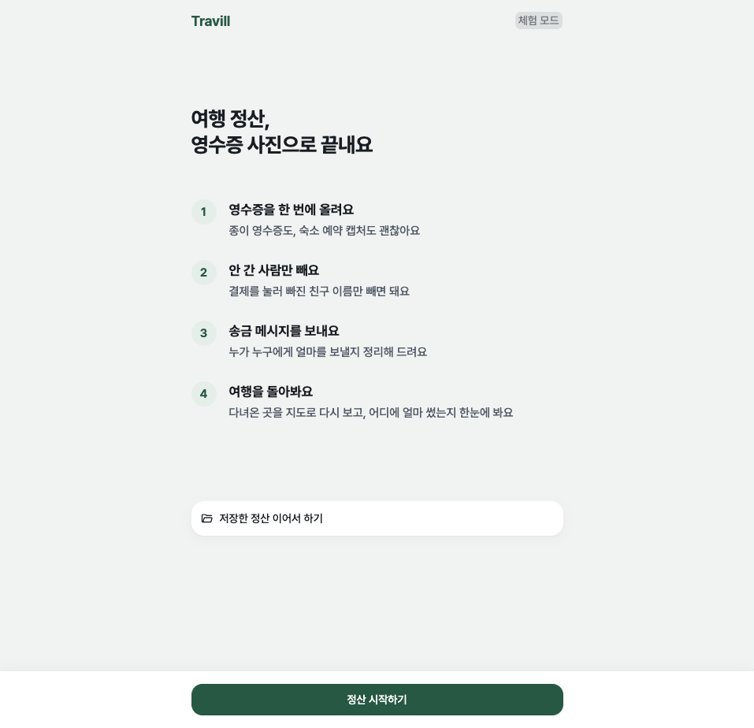
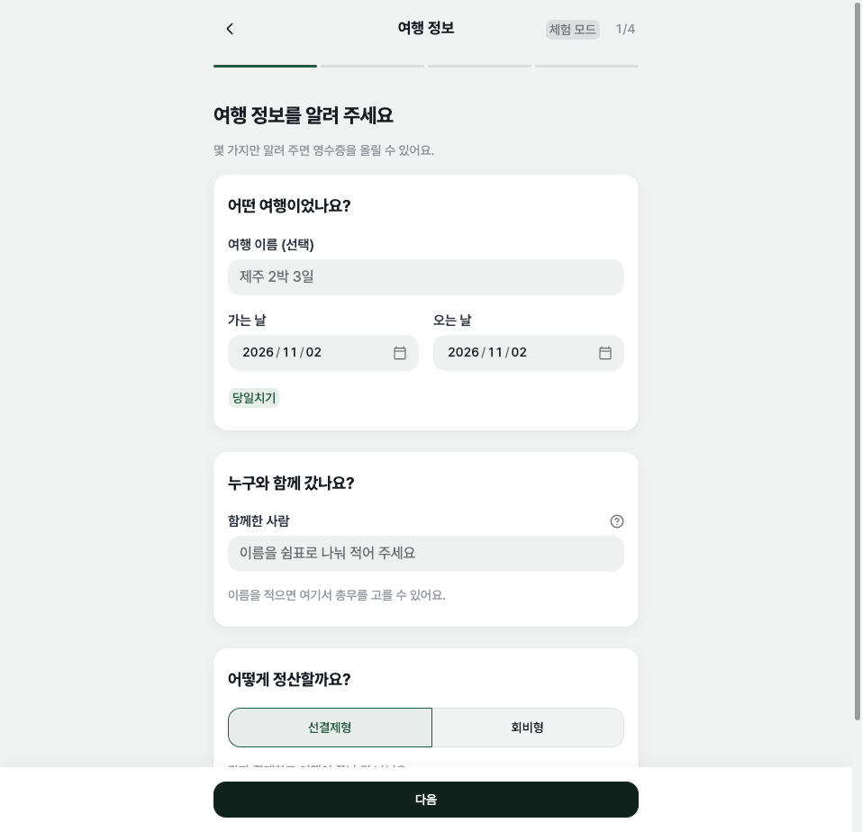
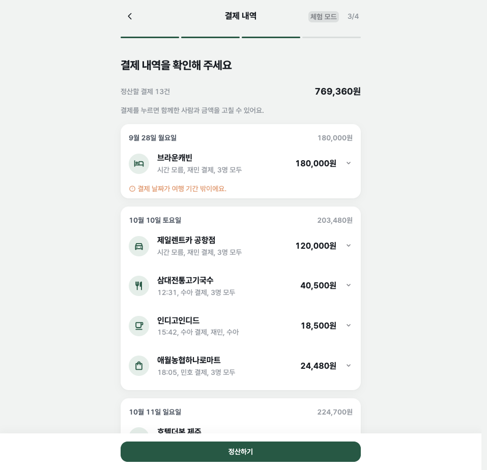
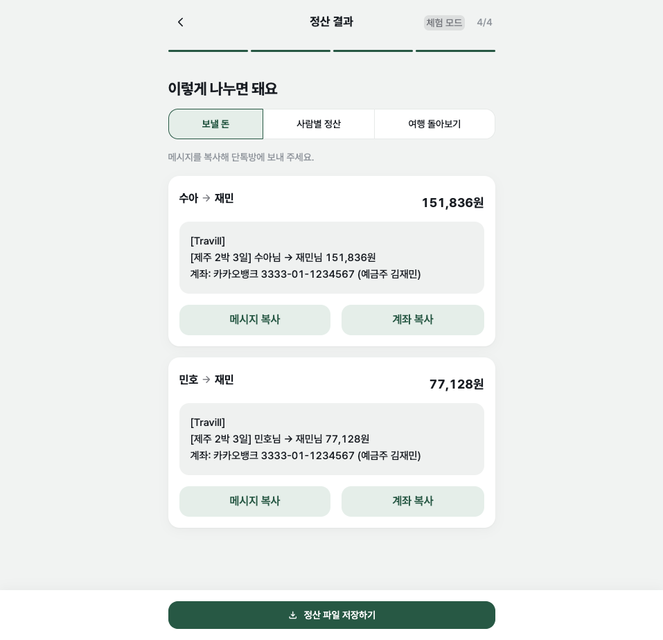
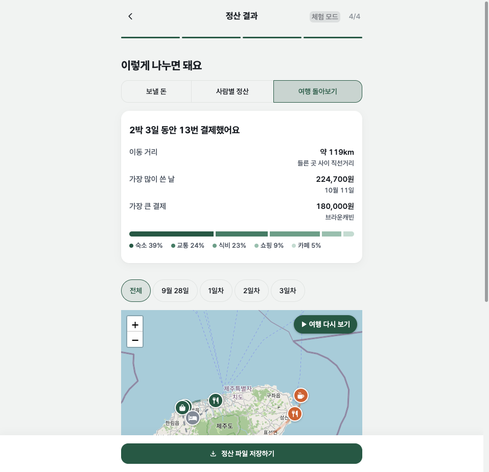

# Travill(트래빌) · 여행 영수증 정산

여행이 끝난 뒤 영수증 사진을 한 번에 올리면 AI가 가게 이름·결제 시각·금액을 읽는다. 결제마다 결제한 사람과 함께한 사람을 정하면, 누가 누구에게 얼마를 보낼지와 송금 메시지를 만들어 준다.

| | |
|---|---|
| **배포** | https://travill.streamlit.app/ · 시작 화면의 **예시 여행으로 둘러보기**로 영수증 없이 모든 화면을 볼 수 있다 |
| **시연 영상** | [`docs/demo/travill-demo.mp4`](docs/demo/travill-demo.mp4) (1분 55초) · 만든 과정 [`docs/demo/making-of.md`](docs/demo/making-of.md) |
| **발표 자료** | [`docs/presentation/travill.pdf`](docs/presentation/travill.pdf) · HTML [`docs/presentation/index.html`](docs/presentation/index.html) |
| **프롬프트** | [`프롬프트.md`](프롬프트.md) · AI 활용 기록 [`docs/ai-log.md`](docs/ai-log.md) |

## 왜 만들었나

여행이 끝나면 총무에게 정산 일이 남는다.
- **옮겨 적기:** 영수증과 예약 캡처가 열 장 넘게 쌓이고, 가게·시각·금액을 손으로 옮겨 적는다.
- **빠진 사람:** "카페에는 누가 빠졌더라?"를 기억에 기대 1/N로 나눈다.
- **결제자가 여러 명:** 숙소는 총무, 밥은 친구가 내면 누가 누구에게 얼마를 보낼지 계산이 꼬인다.

## 쓰는 흐름

| 단계 | 화면 | 하는 일 |
|---|---|---|
| 1 | 여행 정보 | 여행 이름·날짜, 함께한 사람, 총무, 정산 방식(선결제형 / 회비형), 총무 계좌(은행·계좌번호·예금주) |
| 2 | 영수증 올리기 | 영수증·예약 캡처를 한 번에 최대 30장. 3장씩 병렬로 읽고 시간순으로 정렬한다 |
| 3 | 결제 내역 | 날짜별 목록. 결제를 누르면 펼쳐져 함께한 사람·금액·시각·결제한 사람을 고친다. 중복 의심 결제를 알리고, 영수증 없는 지출을 직접 더한다 |
| 4 | 정산 결과 | 탭 세 개. **보낼 돈**(송금 횟수가 적게 짝짓기, 메시지 복사·계좌 복사), **사람별 정산**(낸 돈 / 부담할 돈 / 차액), **여행 돌아보기**(요약 카드, 날짜별 경로 지도, 자동차 다시 보기, 날짜별 동선) |

- **정산 공식:** 사람마다 `차액 = 낸 돈 − 부담할 돈`이다. 부담할 돈은 함께한 결제마다 금액을 함께한 사람 수로 나눠 더한 값이다. 1원 단위 나머지는 결제한 사람이 낸다.
- **회비형:** "회비 지갑"을 가상의 참여자로 두어 같은 공식으로 계산한다.
- **정산 파일:** 결과를 JSON으로 내려받았다가 시작 화면의 **저장한 정산 이어서 하기**로 다시 불러온다.

| 시작 | 여행 정보 | 결제 내역 | 보낼 돈 | 여행 돌아보기 |
|---|---|---|---|---|
|  |  |  |  |  |

## 평가 결과

생성 영수증 13장(종이 영수증 9장, 숙소·렌터카 예약 캡처 4장)으로 인식 정확도를 쟀다. **핵심 3필드**는 가게 이름·결제 시각·결제 금액이 모두 정답인 비율이다.

| 인식기 | 프롬프트 | 핵심 3필드 | 가게 이름 | 결제 시각 | 결제 금액 |
|---|---|---|---|---|---|
| 로컬 `qwen3-vl:8b-instruct` | v1 | 76.9% (10/13) | 100% | 84.6% | 92.3% |
| 로컬 `qwen3-vl:8b-instruct` | **v2** | **92.3% (12/13)** | 100% | 92.3% | **100%** |

**v1이 틀린 원인과 v2에서 더한 규칙**
- **예약 캡처:** 체크인·대여 시각을 결제 시각으로 읽었다. v2에 "결제일만 있으면 시각을 지어내지 않는다"를 더했다.
- **돌아간 영수증:** 결제금액 대신 과세물품가액을 읽었다. v2에 "과세물품가액·부가세는 결제 금액이 아니다"를 더했다.

**한계**
- 13장뿐인 생성 이미지이고, 같은 이미지를 보고 고쳐 향상이 실제보다 크게 보일 수 있다.
- 호텔 예약 1건은 v2에서도 체크인 시각을 결제 시각으로 읽는다.
- Gemini는 무료 하루 한도 때문에 13장 중 8장만 쟀고, 그 8장은 모두 정답이었다.

자세한 기록은 [`docs/ai-log.md`](docs/ai-log.md) 3장에 있다.

## 로컬 실행

```bash
git clone git@github.com:KJM0424/travel-bill-wanted1.git
cd travel-bill-wanted1
./scripts/setup_worktree.sh        # .venv 생성, 패키지 설치, .env 준비
# .env에 키를 채운다 (아래 "설정 값")
.venv/bin/streamlit run app.py
```

- **키 없이 화면만 보기:** `RECOGNIZER=mock .venv/bin/streamlit run app.py`로 실행한다. AI를 부르지 않고, 미리 저장한 인식 결과(`tests/fixtures/receipts/`)를 돌려준다.
- **예시 여행:** 시작 화면의 **예시 여행으로 둘러보기**를 누르면 `eval/demo_trip.json`을 불러온다.
  - 생성 영수증 13장으로 만든 제주 2박 3일 여행이다.
  - 결제자 3명, 첫날 카페에 빠진 친구, 여행 기간 밖에 미리 결제한 숙소가 들어 있다.
  - 가게는 실제 제주 가게이고 거래는 지어낸 것이다.

### 로컬 모델(Ollama)
Gemini 대신 이 컴퓨터에서 도는 비전 모델로 읽는다. 호출 한도와 비용이 없고 사진이 외부로 나가지 않는다. Streamlit Cloud에는 GPU가 없어 배포판에서는 쓰지 않는다.
1. [Ollama](https://ollama.com/download)를 설치하고 실행한다.
2. `ollama pull qwen3-vl:8b-instruct`를 실행한다(6.2GB, 실행 중 메모리 약 10GB).
3. `RECOGNIZER=ollama .venv/bin/streamlit run app.py`로 앱을 켠다.

`qwen3-vl:8b`(생각 단계가 있는 버전)는 같은 영수증에 약 3배 오래 걸린다.

## 설정 값
로컬은 `.env`, 배포는 Streamlit Secrets에서 읽는다(`core/config.py`). 빈 값은 없는 것으로 본다.

| 이름 | 설명 |
|---|---|
| `GEMINI_API_KEY` | Gemini API 키. [Google AI Studio](https://aistudio.google.com/apikey)에서 발급한다 |
| `GEMINI_MODEL` | 비우면 `gemini-3.5-flash` |
| `RECOGNIZER` | `gemini`, `ollama`(로컬 전용), `mock`. 비우면 `gemini` |
| `OLLAMA_MODEL` | 비우면 `qwen3-vl:8b-instruct` |
| `OLLAMA_HOST` | 비우면 `http://localhost:11434` |
| `APP_PASSWORD` | AI로 영수증을 읽을 때만 묻는 비밀번호(무료 하루 한도 보호). 예시 여행, 정산 파일 불러오기, 직접 입력은 비밀번호 없이 된다. 비우면 묻지 않는다 |
| `KAKAO_REST_API_KEY` | 경로 지도용. [카카오 개발자](https://developers.kakao.com/)에서 발급하고 카카오맵(지도·로컬) 사용을 켠다. 없으면 지도 자리에 안내만 나오고 정산은 그대로 된다 |

`.env`와 `.streamlit/secrets.toml`은 커밋하지 않는다(`.gitignore`에 있음).

## 테스트·평가

```bash
.venv/bin/pytest                                              # 단위 테스트 + 화면 테스트(AppTest), 404개
.venv/bin/ruff check . && .venv/bin/ruff format --check .
.venv/bin/python -m eval.run_eval --prompt v2 --recognizer ollama --source synthetic
.venv/bin/python -m eval.run_eval --prompt v2 --source synthetic --interval 13   # Gemini, 분당 한도 대비 13초 간격
```

- **정답:** 정답은 `eval/ground_truth.json`에 있고, 라벨링 규칙은 `eval/LABELING.md`에 있다. 평가 결과 원본은 `eval/results/`에 남고 커밋하지 않는다.
- **생성 영수증:** `eval/synthetic_specs.json`을 바꾸면 영수증 이미지와 예시 여행을 다시 만든다. 둘이 어긋나면 테스트가 실패한다.
  ```bash
  python -m eval.make_synthetic --font <ttf>
  python -m eval.make_demo_trip
  ```
- **실물 영수증 사진:** `eval/images/real/`에 두고 커밋하지 않는다.

## Streamlit Community Cloud 배포

1. [share.streamlit.io](https://share.streamlit.io)에서 GitHub 저장소 `KJM0424/travel-bill-wanted1`, Branch `main`, Main file `app.py`로 앱을 만든다. Cloud는 main이 바뀔 때마다 다시 배포한다.
2. **Advanced settings**에서 Python 3.12를 고르고 Secrets에 넣는다.
   ```toml
   GEMINI_API_KEY = "발급받은 키"
   GEMINI_MODEL = "gemini-3.5-flash"
   RECOGNIZER = "gemini"
   APP_PASSWORD = "데모 비밀번호"
   KAKAO_REST_API_KEY = "카카오 REST API 키"
   ```
   쓰지 않는 키는 빈 문자열로 두지 말고 줄을 뺀다. Streamlit은 Secrets 값으로 같은 이름의 환경변수를 덮어쓴다.
3. 배포 URL에서 확인한다.
   - 예시 여행으로 둘러보기 → 결제 내역 → 정산 결과의 세 탭이 보이는지 본다.
   - 업로드 화면에서 비밀번호를 넣고 실제 영수증을 올려 송금 메시지가 나오는지 본다.

**휴대폰:** "홈 화면에 추가"를 하면 주소창 없이 앱처럼 열리도록 `static/manifest.json`을 넣었다. 다만 배포판은 Streamlit Cloud가 앱을 틀(iframe) 안에 넣어 보여 줘서 적용되지 않을 수 있다.

## 데이터와 개인정보
- **사진 처리:** 업로드한 사진은 서버 디스크에 저장하지 않는다. AI로 보내기 전에 EXIF를 지우고 긴 변을 1500px로 줄인다.
- **카드번호·승인번호:** 추출하지 않는다. 스키마와 프롬프트 양쪽에 적었다.
- **외부 전송:** 배포판은 사진을 Google Gemini API로 보낸다. 업로드 화면에 이 사실과 "카드번호와 이름은 가리고 올려 주세요"를 안내한다. 로컬 모델 모드에서는 사진이 밖으로 나가지 않는다.
- **무료 등급 약관:** 무료 등급 입력은 서비스 개선에 쓰일 수 있다고 정리했다. 약관 원문은 [Gemini API 추가 약관](https://ai.google.dev/gemini-api/terms)에서 확인한다.
- **키 관리:** 키는 `.env`와 Streamlit Secrets에만 두었고, 개발 대화 기록에서도 키 문자열이 나오지 않았음을 확인했다.

## 한계
- 원화(KRW)만 지원한다. 외화 영수증은 경고하고 제외한다.
- 품목 단위로 나누지 않는다. 한 결제의 금액을 함께한 사람에게 1/N로 나눈다.
- 로그인과 저장소가 없다. 새로고침하면 정산이 사라지므로 정산 파일을 내려받아 두고 다시 불러온다.
- 송금 링크에 금액이 미리 채워지는지는 확인하지 않았다. 메시지에 금액을 글로 함께 넣는다.
- 교통비(렌터카·주유·배표)와 직접 더한 지출은 한 장소가 아니라 지도에 찍지 않는다. 금액은 요약과 날짜별 합계에 들어간다.
- 실물 영수증으로 평가하지 않았고, Gemini 비교는 13장 중 8장만 했다.

## 구조
- **`app.py`, `ui/`:** 화면. 단계별 화면, 세션 상태, 지도·복사 버튼, 비밀번호(`ui/access.py`), PWA 머리말(`ui/pwa.py`)
- **`core/`:** 계산과 바깥 호출. streamlit을 import하지 않는다(`core/config.py`의 선택적 import 제외).
  - `schema.py`: 공통 데이터 약속 `Receipt`·`Expense`·`Trip`
  - `recognizer/`: Gemini·Ollama·Mock 인식기. 셋 다 같은 함수 모양 `recognize(image, prompt_version) → Receipt`
  - `recognize_service.py`: 3장씩 병렬 인식
  - `expense_builder.py`: 결제 건 변환과 중복 찾기
  - `settlement.py`: 정산과 송금 짝짓기
  - `payment_message.py`: 송금 메시지와 계좌
  - `geocode.py`, `kakao_client.py`: 카카오 위치 찾기
  - `trip_story.py`: 여행 요약과 곡선 경로
- **`prompts/`:** 인식 프롬프트 `v1.md`, `v2.md`(앱 기본). 바꾸면 `docs/ai-log.md`에 기록한다.
- **`eval/`:** 정답, 지표, 평가 스크립트, 생성 영수증과 예시 여행 생성기
- **`scripts/`:** 작업 공간 준비, 시연 영상 녹화(`record_demo.py`)와 편집(`make_demo_video.py`)
- **`docs/`:**
  - [`ai-log.md`](docs/ai-log.md): AI 활용 기록. 요청 원문, 단계별 역할, AI 실수 12건, 회고
  - [`stability.md`](docs/stability.md): 안정성 점검
  - [`design-notes.md`](docs/design-notes.md): 디자인 판단
  - 설계 [스펙](docs/superpowers/specs/2026-11-01-trip-receipt-split-design.md)과 [구현 계획](docs/superpowers/plans/2026-11-01-trip-receipt-split.md)
